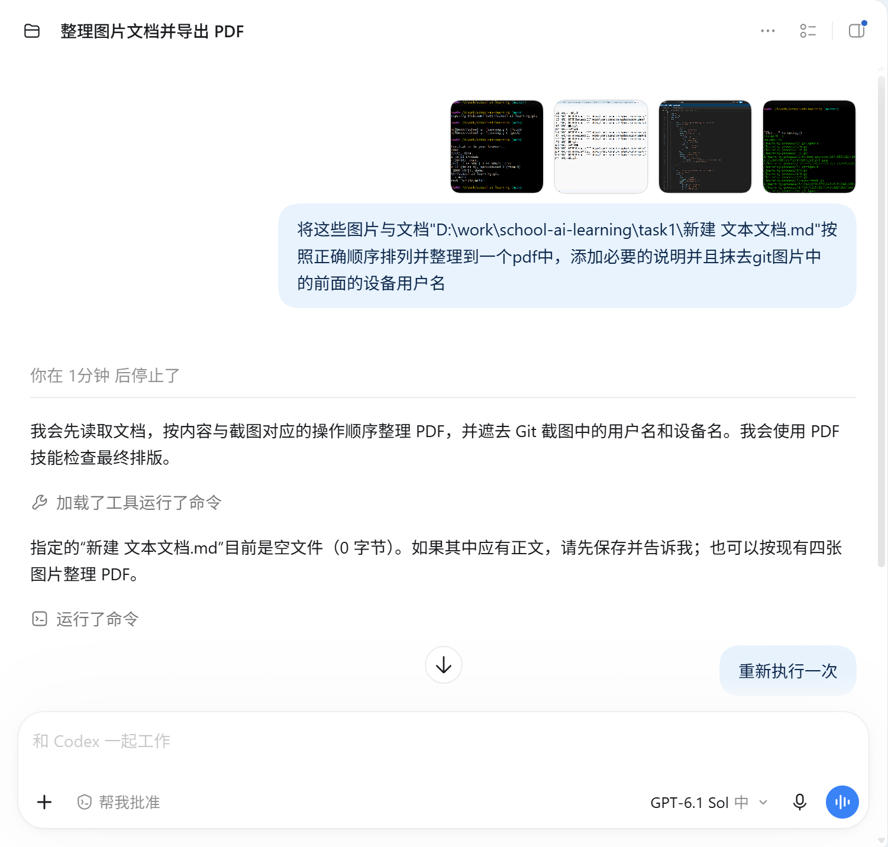

###### 本文件为阐述ai学本次任务完成的帮助，未说明为agent的ai帮助均为chat。不会直接复制一整段ai给出的代码，只会在没有头绪和不知道标准写法时复制ai给出的一两行代码或一小块代码块。

###### 有些使用deepseek的快速问答（常见于忘记代码写法和参数位置等）没有写入文件

设置学习任务与阶段：

https://chatgpt.com/share/6aef820a-2a94-83ee-94e6-3cbf29171fa6

学习并完成设置的任务一：

https://chatgpt.com/share/6aef8277-6d28-83ec-af37-436907d1cdcf

学习并完成设置的任务二：

https://chatgpt.com/share/6aef366c-07d0-83e8-9b73-9435930cdf94

学习并完成设置的任务一：

https://chatgpt.com/share/6aef5958-bb64-83ec-9594-7f3a1e803cae

学习并完成设置的任务一：

https://chatgpt.com/share/6aef769a-9924-83ee-b04f-8c2c90f3b319

编写README：

https://chatgpt.com/share/6aef814d-0d90-83e8-9b18-1fb70d39d470

编写pdf（agent）：

